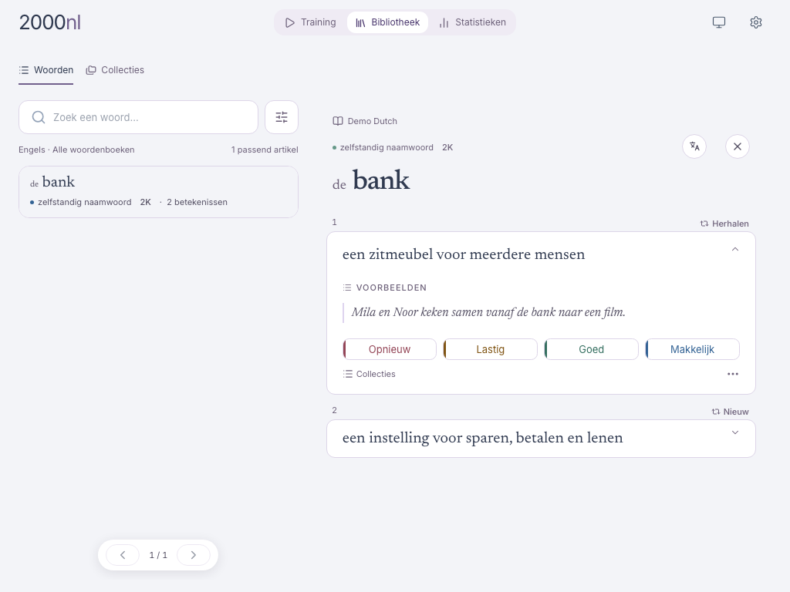
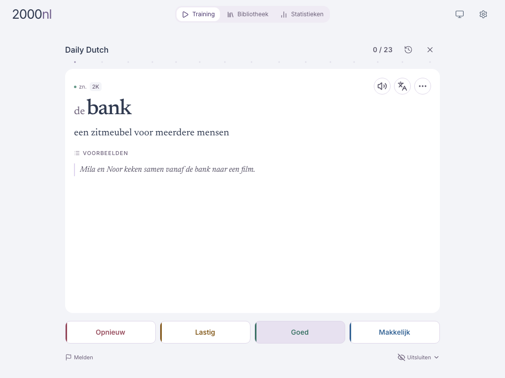

# 2000NL

**Vocabulary flashcards with spaced repetition.**

Build your personal dictionary, save useful meanings and examples, and practise
words across languages. 2000NL brings vocabulary learning, personal collections
and flashcards together. Our first in-house dictionary focuses on Dutch.

[Visit Dilum](https://dilum.io) · [Open the app](https://2000.dilum.io) · [Run your own copy](docs/development.md)

- **Save a precise meaning.** Keep useful examples and context alongside each word.
- **Make it yours.** Organise your vocabulary into personal collections.
- **Build lasting recall.** Practise with cards for individual meanings and spaced repetition.

*Screenshots show the application with independently written demonstration data.*

## Part of a connected learning experience

2000NL is the vocabulary foundation of the [Dilum](https://dilum.io) language-learning
ecosystem: **AudioFilms** focuses on active listening and shadowing with audio
and video; **Pontix** brings
translation to your browser. The aim is one personal word library across the
ways you learn. These connections are evolving.

## For flashcard learners

Anki and Quizlet are familiar ways to study with flashcards. 2000NL centres the
workflow on a personal dictionary: save the meaning you need with context,
organise it, and practise it.

## Open code, your choice of hosting

The application and dictionary data formats are available under [Apache 2.0](LICENSE).
Run your own copy, adapt it, or use the hosted app. Full dictionaries, proprietary
translation prompts and dictionary creation tools are separate from this release.
A small demonstration dataset is included so you can explore the application.

[How it fits together](docs/architecture.md) · [Code and content](CONTENT-LICENSING.md) · [Contributing](CONTRIBUTING.md)
