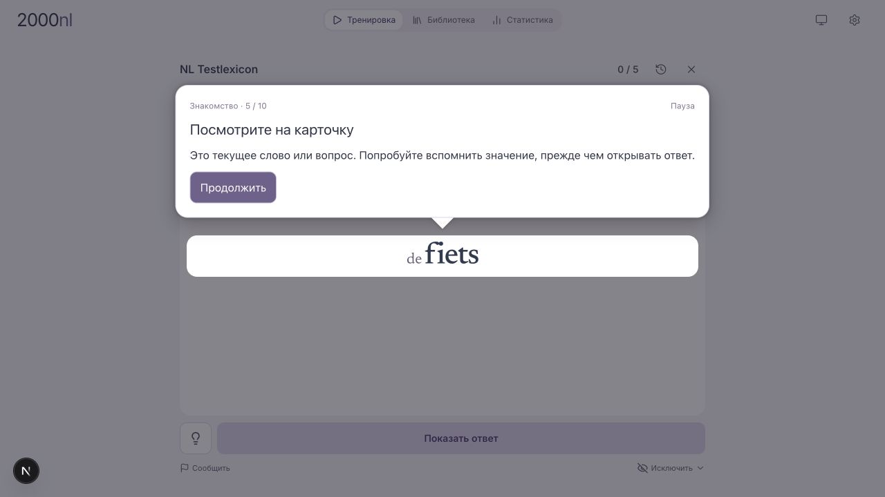
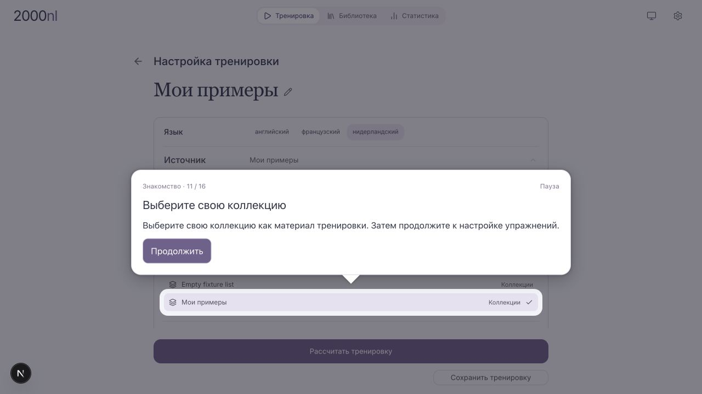
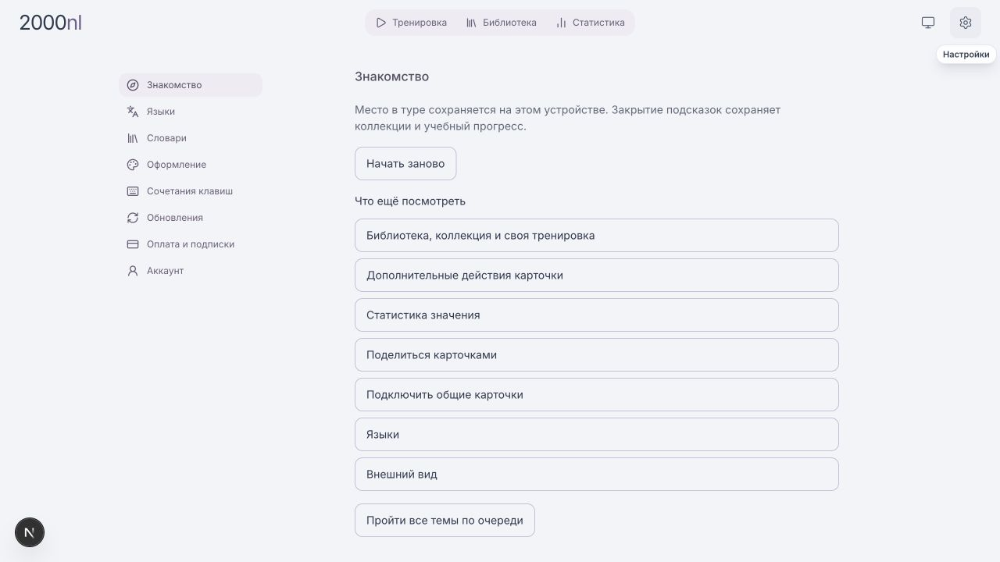

# Application onboarding

The approved spotlight format now runs inside `TrainingScreen`, on the normal
application route, with an independent Getting started entry at the top of Settings.
The dev preview remains available for historical design review, but the application
imports neither its controllers, fixture cards nor preview storage.

## Behavior

- First use starts with the saved supported interface language (English fallback).
  Language controls write the existing account preferences and translate the tour
  immediately. The translation language is independent; the second language is
  mentioned as a later option. A pending invitation or resumable session does not
  trigger an automatic interruption.
- The short introduction opens a real training, introduces its word/question,
  reveals the answer, explains Learn or rating, and waits for an accepted learning
  action before guiding the learner out of the session.
- Optional topics cover selecting a meaning, actual collection membership,
  creating/configuring/saving a training, speaker/details/report, meaning progress,
  owner invitations, receiving an invitation, languages and appearance. Available
  topics follow the installation's existing feature flags. They can run individually
  or in sequence.
- Search is prepared from the current training word (Dutch `bank` fallback). During
  the library topic it is read-only and cannot be cleared accidentally. The source
  picker highlights a collection actually assigned to the meaning, not a fixed name.
- Sharing follows the normal publication confirmation and copies only a real
  invitation. Receiving requires a real invitation supplied by the user; there is
  no fabricated code or auto-acceptance in the application. The normal backend
  rollout/permission fences remain authoritative.
- Missing/disabled targets expose pause/restart recovery after a bounded wait.
  Native dialogs and popover menus keep their usual close/confirmation behavior.
  Pausing closes transient panels using their existing dismiss callbacks; resume
  reopens them through the real control. Unsaved mounted training drafts stay owned
  by the normal training controller.

## State and localization

Stable topic and step IDs live in `apps/ui/lib/onboarding/model.ts`; EN/NL/RU prose
is in `apps/ui/lib/onboarding/locales/`. UI controls expose small stable target
attributes. The guide does not call learning, collection, sharing or report APIs.
Accepted learning, save and clipboard results emit action-only signals; failed
commands do not complete those guide steps.

The validated checkpoint `2000nl:onboarding:v1:<encoded-user-id>` is account-scoped
on this device, separate from prototype storage. Pause is not completion. A full
reload resumes at the current topic's stable beginning; it does not fabricate an
open editor or restore unsaved modal input. This limit is stated in the introduction.
Core completion uses the existing account onboarding preference. Checkpoints and
optional topic progress are not synchronized across devices. Storage failures are
visible and do not prevent manual topic selection.

No database migration, new credential, production traffic change or managed release
is part of this application change.

## Validation

Local Supabase with the public synthetic fixture and a designated QA account:
interface selection EN → RU, translation choice, complete card introduction/reveal/
accepted Learn/exit, prepared library search, actual collection assignment, chosen
collection material, exercises and successfully saved named training.
259 unique focused/regression tests passed across the relevant navigation, settings,
learning, sharing, builder and guide modules; UI typecheck and lint passed. Browser
checks also covered pausing an actual progress sheet, resuming via its status trigger,
restoring RU after reload and all three theme modes.
Shared invitation writes still require the installation's existing write rollout.
The isolated preview is not evidence of account integration.

