# Current first-use and legacy tour audit

2026-10-30 · public commit `d72b9d5e1d65dbee2d86abea619a701d8ece7d62`.
This report distinguishes observed product behavior, source evidence, and design
hypotheses. It does not certify the pending #8 defaults or beginner comprehension.

## Environment and limits

Current app ran with its own installed dependencies and the default pilot profile.
Port 3100 was free before starting the audit-owned process. A separate local
Supabase project `2000nl-onboarding-9` used API 55521 / DB 55522, the unmodified
public baseline 287 and public synthetic `search_multisource` / `training_smoke`
fixtures. No shared database, retained corpus QA project, production or enrichment
process was used or reset. No private dictionary content was imported.

The installed local QA skill names wrappers absent from the public checkout.
Instead the public `setup-local.sh` logic was executed against the explicitly
isolated port, with its nonempty-schema refusal and checksum verification intact.
The UI received only local credentials; dev login used a synthetic marked QA
account. Deep health was `ok`, target `local`, contract 287 compatible, all five
checks `ok`, sentence exercises off, translation worker off. No provider keys
were supplied. Runtime helpers and credentials are local-only, outside this report.

Captured and inspected using Codex IAB. Real product captures 01–08 are current
backend-backed behavior, not mocked API responses. Captures 09–11 are explicitly
the separate simulated proposal. All saved screenshots were reopened and inspected.

## Numbered current-product walkthrough

1. **Fresh account / overview — blocked first useful action in this fixture.**
   No tour or language modal appeared. Main card was `Core vocabulary`, with
   zero matching cards and no saved trainings. The page offered Edit training.
   This demonstrates the pre-#8 fallback with these demo sources; it is not a
   claim that Dilum NL defaults fail, because #8 was not installed.

   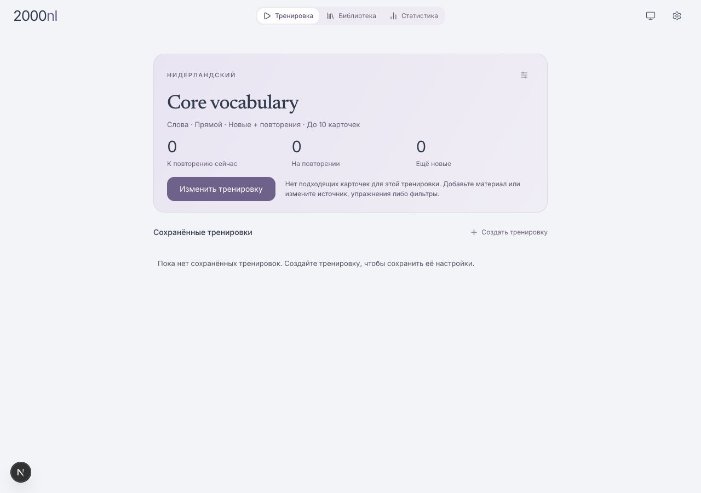

2. **Editor / available material — usable, concept-heavy.** Selected dictionary
   `NL Testlexicon`, direct word exercise and five-card session, then Calculate.
   The overview then listed the named saved training. Source distinguishes
   dictionaries from collections, but no explanation of that distinction appears.
   Exercise UI shows Words, Idioms and Translation; typed answer is disabled.
   Source inspection identifies visible Translation as `word-in-context`, which
   is distinct from launch-gated `sentence`. Neither was exercised in this audit.
   Do not infer sentence availability from the translated visible label.

   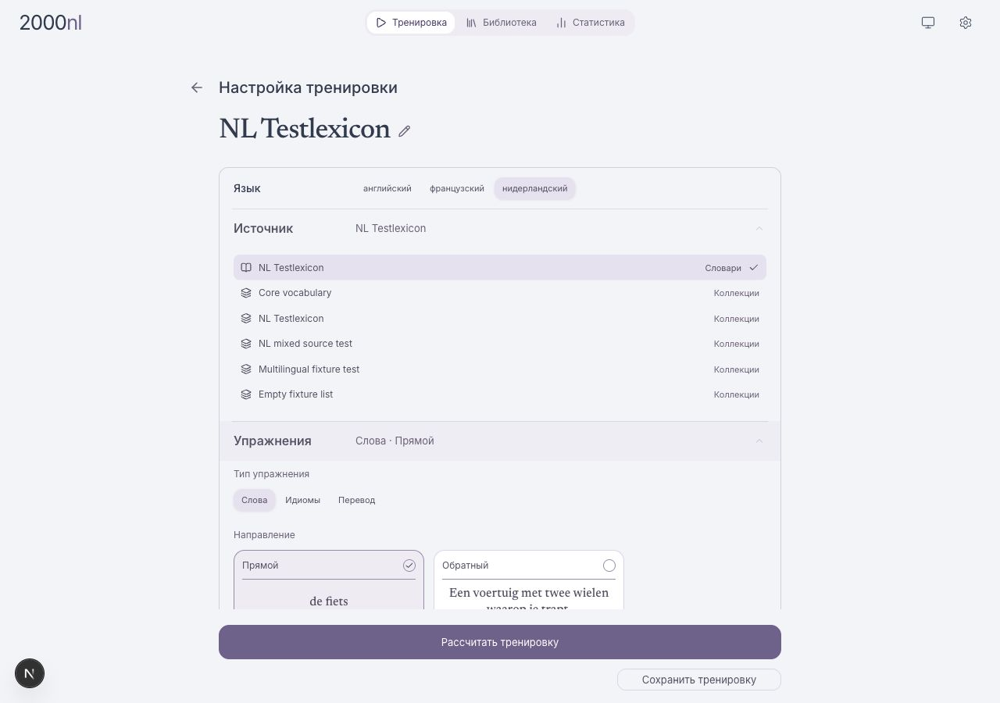

3. **Start / first card — usable.** Started the real saved demo training.
   First card `thuishaven`, 0/5, Show answer/Hint and ordinary tools. Read-only
   DOM inspection found only `[data-tour=settings-button]` among tour markers;
   no training-card, rating-buttons or card-toolbar markers were present.

   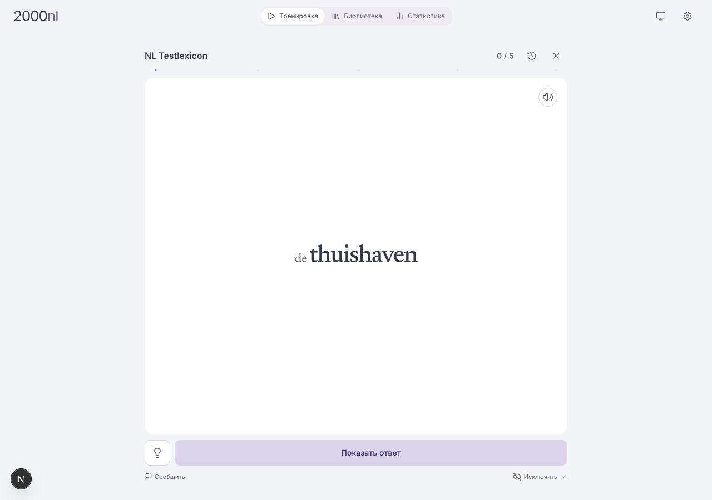

4. **First answer / learning action — usable; old ratings lesson does not fit.**
   At 390×844, definition and example are readable; primary action is **Учить**
   (Learn), not four ratings. Clicking it successfully advanced to 1/5 and `fiets`.
   Audio and translation provider success were not established. Automatic
   translation requests returned 500 with no provider resources configured;
   translations are not an audit pass. Core reading and Learn worked without
   them. Mobile session layout hides the global app navigation.

   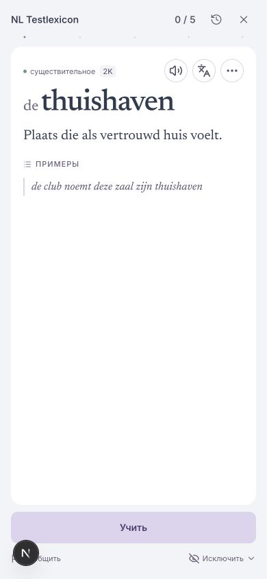

5. **Reload / interruption — session continuity works in this case.** Reload
   returned to `fiets` at 1/5. Exit returned to a Current training card with 1 done,
   4 remaining and Continue. This is actual session resume, not tutorial resume.
   Focus outline was visible on the resumed card container.

   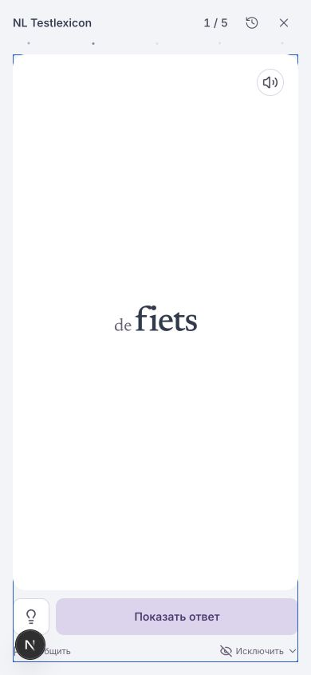

6. **Library / meaning — usable; specific sense grouping not validated.** Search
   `bank` returned two articles, each labelled one meaning in the synthetic fixture.
   Opened the financial meaning and read its example. The meaning's Collections
   control is available. This fixture does not demonstrate several meanings in
   one rendered article; that part of the mental model still needs a suitable
   approved test entry. No forced corpus query or private content was used.

   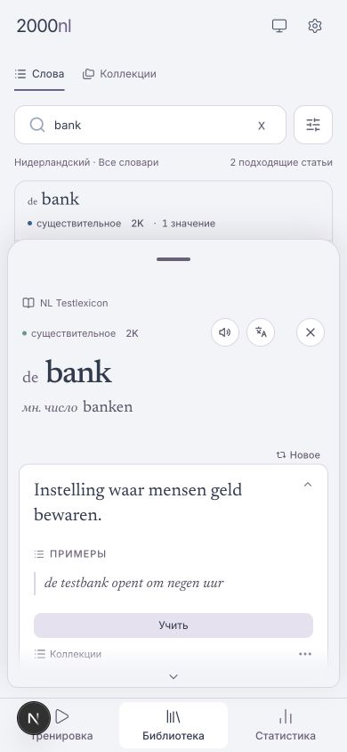

7. **Collection create/add — usable after a separate naming task.** Opened
   Collections → New collection → entered `Мои примеры` → Create. After server
   acknowledgement it showed one item, checked membership and “Состав коллекций
   обновлён”. Done restored focus to Collections · 1 on the underlying meaning.
   Training from this collection and shared progress across two collections were
   not exercised in the live app. They remain acceptance cases, not audit passes.

   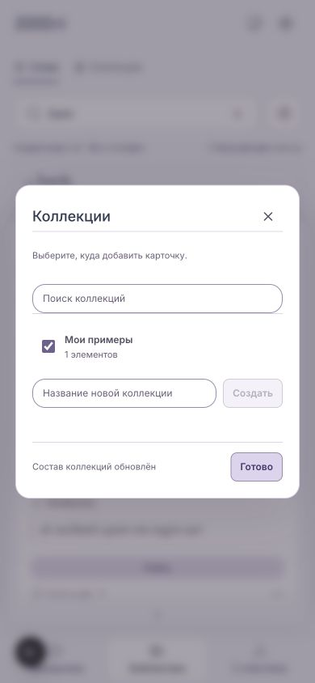

8. **Settings / language — usable; no replay entry.** Mobile settings offers
   Languages, Dictionaries, Appearance, Shortcuts, Updates, Billing, Account.
   No Introduction/Replay control is visible. Switched interface language from
   Russian to English; reload retained English. SQL readback of the synthetic
   account showed `onboardingLanguage`; fresh account initially had no completion
   flag. Separate flag checks are recorded in validation below.

   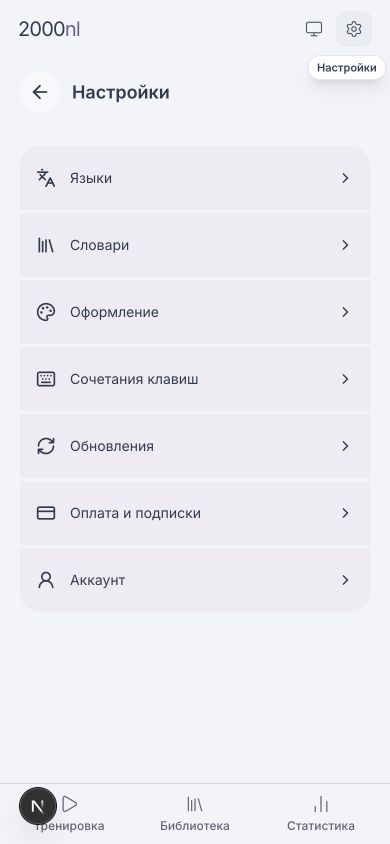

## Proven legacy-tour findings

| Finding | Evidence | Consequence |
| --- | --- | --- |
| No production launch route in this snapshot | `useTrainingOnboarding.ts`: runTour=false, showLanguageSelection=false; only startOnboarding/handleLanguageSelect can turn it on. TrainingScreen consumes neither startOnboarding nor setShowLanguageSelection; modal is passed false. Repo-wide callers of startOnboarding are hook tests | Missing/false completion does not auto-start; Settings cannot replay |
| Three obsolete targets | STEP_TARGETS names training-card, rating-buttons, card-toolbar; no producers found in current components; live first-card DOM has only settings-button | Restoring a trigger alone would not restore the tour |
| Incorrect action assumed for new cards | Step 3 asks to rate; real first answer has Learn | First-use text must branch on real card/action capability |
| Existing test name overclaims | TrainingScreen test “five reachable tour targets” only asserts five translation entries | Passing test is not evidence of reachability |
| No durable step or skip distinction | Boolean completion writes true for finished and skipped; no step stored; runTour local only | No tutorial resume, no migration-ready versioned state |
| Language behavior is live | hook initializes/stores onboardingLanguage and supplies onboardingLang to most of TrainingScreen; Settings calls saveOnboardingLanguageChoice; actual switch survives reload | Do not delete hook wholesale or clear old language keys |

Relevant source: `apps/ui/lib/training/useTrainingOnboarding.ts`,
`apps/ui/components/training/TrainingScreen.tsx`,
`apps/ui/components/navigation/AppUtilityNav.tsx`,
`apps/ui/lib/onboardingI18n.ts`, `apps/ui/locales/{en,nl,ru}.json`.

The dormant hook's completion state is initialized from preferences, but not used
to launch anything. Its language-selection handler can start Joyride when directly
called in tests. Neither this handler test nor forcibly setting React state proves
that a user can launch it. The audit did not inject state to make it run.

## State and error paths: evidence classification

| Case | Observed / source-derived / pending |
| --- | --- |
| Fresh account with absent completion flag | Observed: no tour; language saved; empty fallback in demo |
| Returning account with false/true completion flag | Observed: false + reload showed normal Settings; true + fresh dev session returned to the same real practice at 1/5, in English, without a tour. The flags were patched only on the synthetic account in the audit-owned DB |
| Existing interrupted training | Observed: Learn → 1/5 → reload same card → exit/Continue |
| Empty source | Observed initial no-cards state, Edit available |
| Source access revoked/denied | Not run; proposed recovery contract in README, must test with controlled access fixture |
| Start/write error, offline, simultaneous devices | Not run; existing app recovery code is not proof of these behaviors |
| Old skip/finish persistence | Existing hook tests call callbacks directly, not reachable browser behavior |
| Language write failure | Static finding: updateUserPreferences resolves `{error}`; hook awaits it without inspecting error. Catch handles rejections only. Persistence error can be silently treated as success; not fault-injected in browser |
| Preference merge freshness | Static risk: preferencesRef starts from props and merges local patches, without synchronising later unrelated preferences. New onboarding should not copy this whole-JSON write pattern |

These last two language/preference findings need focused regression coverage in
their own fix. They are not a reason to change storage formats or user choices in
the narrow removal of dead tour UI.

## Independent cleanup plan (not implemented here)

Make a separate cleanup PR with no new onboarding UI or DB migration:

1. Extract the **live** interface-language initialization, storage and Settings
   setter from `useTrainingOnboarding` into a narrowly named language hook. Keep
   `onboardingLanguage` in account JSON, `onboarding_language` in localStorage,
   existing detection order and merging behavior for this removal-only change.
   Keep stored `onboardingCompleted` values unchanged and do not manufacture new
   values. Fixing merge/error behavior can follow with explicit regression tests.
2. In TrainingScreen replace the hook import/destructure with the language hook;
   retain onboardingLang use sites and Settings language callback. Remove Joyride
   import, STEP_TARGETS, buildJoyrideSteps, Joyride render, language modal import
   and render, and the tour-only dark-mode observer.
3. Delete unreachable `LanguageSelectionModal.tsx` and the original hook after
   checking for other references. Remove `getOnboardingTranslation` and its
   tour-only type/imports from onboardingI18n, retaining language helpers and the
   language type used throughout the app. Remove only `onboarding` objects from
   the three locale JSON files; keep all dictionary/card/settings translations.
4. Remove tour-specific tests and replace the misleading five-step assertion.
   Add focused language tests: absent/saved EN/NL/RU; Settings switch does not
   launch UI; reload/storage consistency; preserve true/false/missing legacy
   completion plus unrelated preferences. Keep live existing tests adapted to
   the extracted hook. Do not delete unrelated TrainingScreen cases.
5. Remove the unused `tour` prop / settings marker from AppUtilityNav and update
   its marker assertion; keep Settings accessibility labels/navigation intact.
   Remove `react-joyride` using the package manager and regenerate lockfile; let
   it prune transitive dependencies, do not remove packages by guessed names.
6. Check typecheck, lint touched files and focused hook/TrainingScreen/preferences
   tests. Browser-check no launch for all legacy flags, Settings language switch,
   reload, first card, answer, Library and mobile. Inspect package-lock diff and
   repo-wide references. No setup/defaults/DB module changes.

Why a plan rather than an unverified deletion PR: the unused tour and live
language state are coupled in one hook. Removing only the dependency without
extracting and checking language persistence would not be a safe cleanup. This
design change leaves application behavior and dependencies untouched.

## Prototype walkthrough — separate from product evidence

9. **Orientation, desktop EN — concept walkthrough passed.** One ready saved
   training, Start and Skip. Uses the current product's lavender/white surfaces
   and typographic hierarchy, simplified for content review; not pixel-faithful
   app implementation. Enter starts the simulated card.

   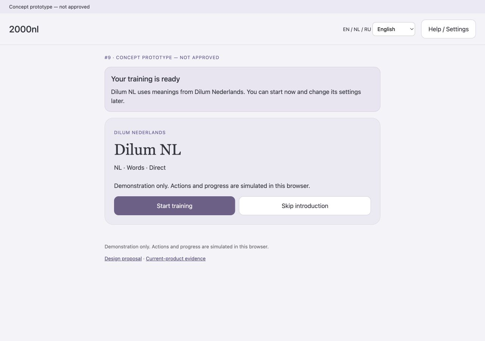

10. **Two actions / optional discovery, mobile RU — concept walkthrough passed.**
    Reveal → Learn twice ends guidance, leaves Continue training primary and
    Library optional. Tested pause → reload → Continue introduction, keyboard
    action focus, collection name/membership and separate collection training.

    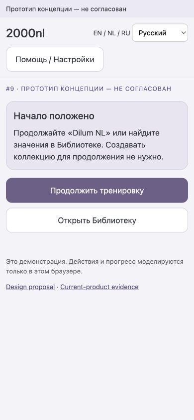

11. **Replay / small NL — concept layout passed with scrolling.** Help →
    Introduction restores guidance without clearing simulated learning or
    collection membership. At 320×568, measured document width 320; no horizontal
    overflow. This full-page capture makes the vertical scrolling visible.

    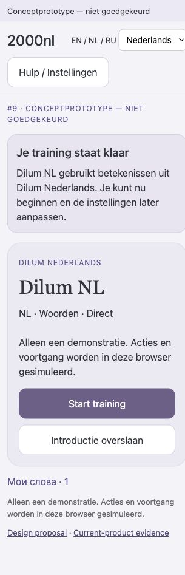

No beginner has reviewed this prototype. Timing, comprehension, completion rate,
screen-reader operation, 200% zoom, #8 integration and cross-device durability
are **not established**. The concept's local browser state is not account storage.

## Accessibility observations

Current product has named primary actions and a visible focus outline on the
resumed mobile card. Collection Done visibly restores focus. Icon-only controls
make a context-specific introduction valuable; screenshots alone cannot establish
their touch areas, full tab order or screen-reader clarity. On mobile, navigation
is absent during active practice, so targeting global Settings mid-card is wrong.

The concept uses native buttons/inputs, visible focus, headings, document language
switching and a polite status region. Explicit action-to-action focus was checked
with Enter. It is a simplified demonstration; full accessibility acceptance must
run against the eventual real components, including dialog focus return, reduced
motion, zoom and longer Russian content.

## Validation record

- Own dependencies installed through the issue worktree helper; no node_modules
  copied or linked. Baseline and public synthetic fixtures loaded only to own DB.
- Deep health: all five checks `ok`, compatible local contract 287. UI pilot;
  sentence gate false, translation worker false.
- Existing `tests/useTrainingOnboarding.test.tsx`: **5/5 pass**. These are direct
  hook tests; they do not demonstrate reachable tour controls. No application
  source was changed, so no broad application regression claim is made.
- Current code and proposal screenshots captured in this run, saved and inspected.
- Missing, false and true legacy completion states checked without forcing a
  tour to run. DOM snapshots for false and true are saved beside the screenshots.
- Real local saved-training readback after fresh dev login: one named training
  `NL Testlexicon`; its saved ID matches the primary ID; language `en` and
  completion `true` retained. This manual demo setup is not #8 validation.
- Concept: EN desktop 1280×900, RU mobile 390×844, NL 320×568 inspected. Native
  Enter actions retain the next action's focus. Pause/reload/resume and
  skip/reload checked; replay keeps simulated learning and collection state.
  Optional create/add and starting a separate collection training exercised.
- All three draft-copy languages have the same 37 nonempty keys; embedded
  prototype JavaScript passes syntax validation. No production credentials,
  external libraries or network API calls are used by the standalone prototype.
- Concept does not model server errors, denied access, two devices, real review
  scheduling, or #8's seeding. Its example bank/fiets cards are simulated; do
  not treat their repeated Learn button as a model of the real scheduler.
- Audit UI and static preview stopped; audit-owned Supabase project stopped with
  its local data retained. No listeners remained on 3100–3103 or preview 8319.
  Pre-existing shared containers remained running. Temporary tabs closed and
  viewport override reset. The standalone HTML remains usable without a server.
