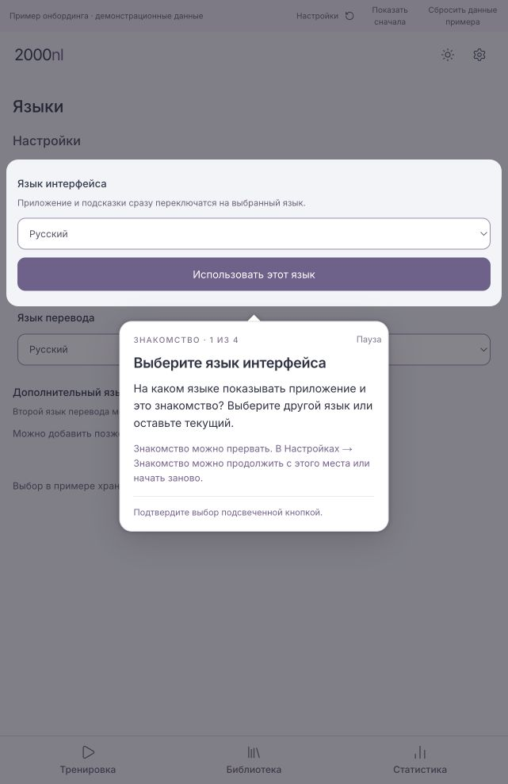
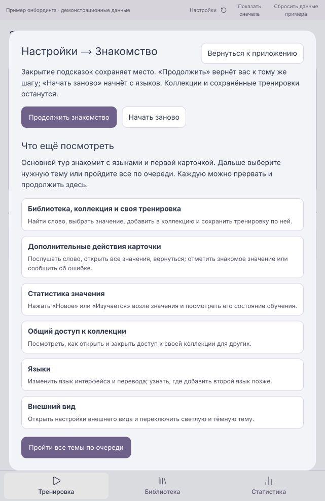
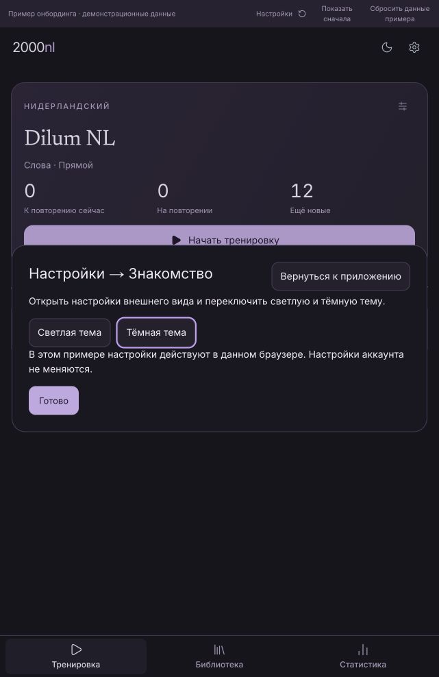
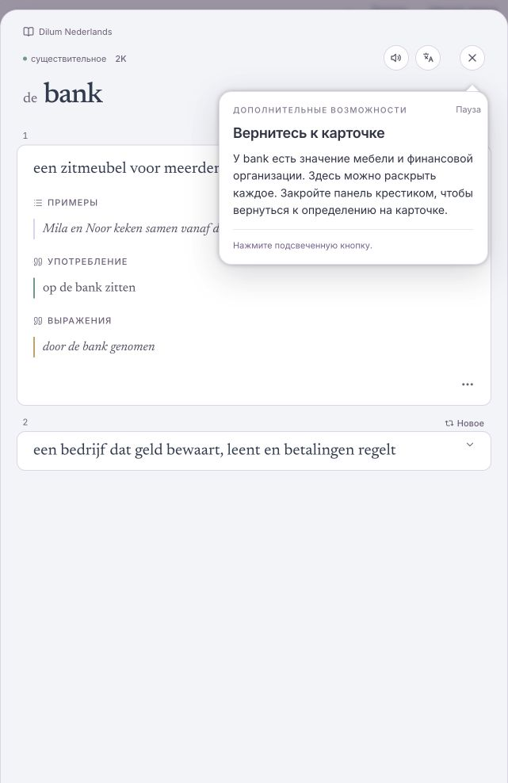
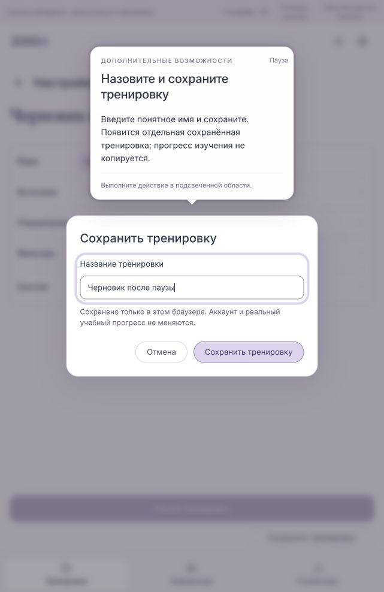

# Action-led onboarding — current review preview

2026-10-30 · #9 · local development prototype, not an account onboarding release.
Open `http://localhost:3100/dev/onboarding-preview`. The route requires development
mode and `ONBOARDING_PREVIEW_9=true`; production returns not found.

## Short introduction and optional topics

Owner feedback replaced the long required route with four core sections:

1. Choose or confirm interface language. Explain how to pause/resume/restart.
2. Independently choose translation language or Off. Mention a second language
   as an option for later.
3. Start the ready Dilum NL training.
4. Introduce the visible word, reveal its definition/example, choose Learn and
   close the session. The first learning action is the main tour's useful result.

The main completion offers Done or Additional possibilities. Settings → Getting
started contains the same topic catalog; select one or Explore all topics in order:

- **Library, collection and your own training:** find bank, choose furniture or
  financial meaning, create/name a collection or use an existing one, return to
  Training, choose the collection as Source, choose Direct, name and save training.
- **More card actions:** speaker → three dots → all meanings → close details →
  Mark as known explanation → Report form → completion. Mark as known is explained
  without requiring a status mutation. Reporting never sends from this preview.
- **Meaning statistics:** highlight the actual New/Learning status button beside
  a meaning. Click opens a local overview for that meaning's definition/status.
- **Collection sharing:** explain owner-managed access, invitation link/code,
  viewing subscribers, closing access/replacing an invitation. A local open/closed
  illustration creates no real link and publishes nothing.
- **Languages:** change interface/translation language and mention the second one.
- **Appearance:** switch actual preview light/dark theme.

The catalog is ordered collections → card actions → statistics → sharing →
languages → appearance for the all-topics option. Completion advances to the next
queued topic, otherwise returns to the catalog. Statistics and sharing are clearly
marked demonstration overviews, not the connected production dialogs. Account
history/scheduling, invitations and publication remain outside this prototype.

## Pause, resume and restart

The tooltip uses a text **Pause tour** button instead of an X, avoiding confusion
with a card/panel's close button. The first tooltip explains Settings → Getting
started → Resume or Start again. Pausing opens that settings destination and
retains the task. Back to app leaves guidance paused and displays a resume banner.
A Settings control also remains available in the preview bar during immersive
practice. The normal settings gear opens this same destination.

A versioned checkpoint retains the current stage, revealed card side, selected
meaning/collection/training, editing training identity, session count, builder
draft/name, theme, settings pane and remaining topic queue. Reload restores the
checkpoint; a paused checkpoint opens settings. Resume restores details panels
and anchors the tooltip inside their native dialog. Card/panel close controls
continue their own action rather than ending onboarding.

Shared editors own transient accordion/dialog state. After reload, Source-pick
returns to the Source opener, Direction-pick to Exercises, training-name to Save,
and collection-name/done to the collection picker. This retains the task and
builder values, requiring a single reopen rather than targeting an absent control.
An unsaved collection-name input is not preserved across a full reload. In-page
pause preserves mounted editor state. Cancel in the training name dialog returns
guidance to Save.

Start again resets the guide/checkpoint draft and begins with languages; it keeps
collections, learned meaning IDs and saved trainings. Reset sample data separately
clears only synthetic journey data. It retains language preferences.

## Components, localization and storage

The spotlight dims the surrounding real interface, highlights the relevant
control and explains the action. Steps follow actual clicks or successful local
saves. Explanatory optional actions do not require mutating a known mark or sending
a report just to continue.

Shared components: AppFrame, TrainingOverview, TrainingSenseCardStage,
LibraryHeadwordGroupResultsList, LibrarySenseCardGroup, LibraryCollectionsPicker,
ApprovedTrainingBuilder and TrainingDetailsDrawer. Installed React Joyride 3.2.0
supplies the spotlight. No dependency was added. No shared production component
was changed for this revision.

Fixture content and training availability are synthetic. There is no account
identity or connected database. Browser speech synthesis provides pronunciation
in this sample, with a Dutch local voice when available. The device-dependent
voice note is shown; this does not test the production audio resolver.

The report trigger uses the existing quiet-action styling and localized labels.
Its preview-only category/comment form has sending disabled and imports no delivery
or outbox client. Field contents are not persisted. The development badge is hidden
on this preview route so it cannot cover the Report button.

Joyride mounts after ancestor transitions, scroll and stable target geometry.
Native dialogs keep their own dimmed backdrop; the tooltip portal is resolved from
the target's current dialog, including after resume. Visible close controls are
chosen rather than hidden fallback buttons. Focus trapping is disabled so actual
controls remain reachable; production accessibility/missing-target recovery still
needs dedicated validation.

Interface language starts from a supported saved choice, otherwise English. The
preview preference takes precedence over an available saved app-language key;
it never writes that app key. Switching immediately translates UI and guidance.
The learning language remains Dutch. Translation language is independent.
EN/NL/RU are supported interface locales; the sample translation choices are
EN/NL/RU/DE/FR/ES and Off, not the full application catalog. No provider is called.

All prose and topic labels are in `apps/ui/app/dev/onboarding-preview/locales/`.
Stable stages/keys are in `content.ts`; topic order is in `PreviewSettings.tsx`.
Future languages need registration and the corresponding application UI messages.

Independent browser stores:

- `2000nl:onboarding-preview:preferences:v1`: interface and translation languages.
- `2000nl:onboarding-preview:journey:v1`: meaning memberships, saved training drafts,
  synthetic learned-meaning IDs. Membership does not copy/reset learning progress.
- `2000nl:onboarding-preview:checkpoint:v1`: validated resume context and editor draft.

Storage errors are surfaced; saves do not pretend success. No account preferences,
DB/defaults/setup-seed, managed rollout or legacy onboarding flags are changed.

## Validation and evidence

27 tests passed for language/fallback/key coverage, independent storage, meaning
identity/membership, saved training persistence, report's no-send/no-storage boundary,
checkpoint context/draft/queue, invalid state/storage and visible-opener restoration.
UI typecheck and touched-file lint passed.

Russian browser checks: short core path; pause/reload/resume on the word face and
inside all-meanings; restored tooltip above the native dialog; statistics badge;
sharing illustration; theme change and restoration of its settings pane; builder
name/collection retained across reload and reopen of Save. Earlier checks cover
collection/training save, card actions and Report. This revision does not claim a
full EN/NL or mobile walkthrough, nor a complete all-topics browser chain.

Screenshots 12–32 retain earlier iterations. This document supersedes their required
13-section route and the earlier standalone HTML design/audit's conditional advice
about removing Joyride. This preview does not validate #8 seeding or account startup.
The local preview server remains running for owner review.
