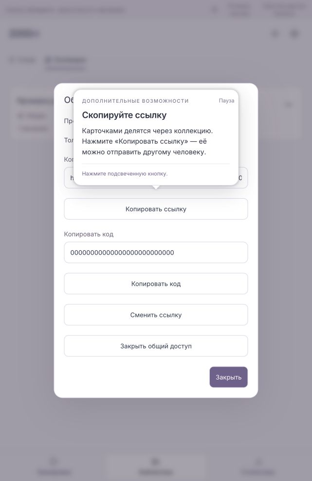
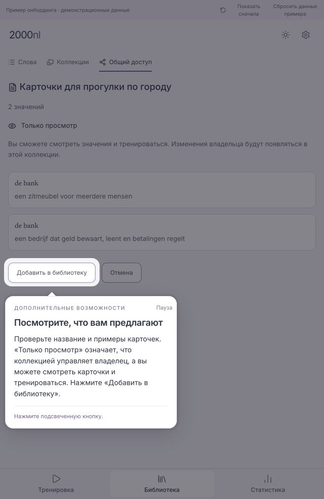
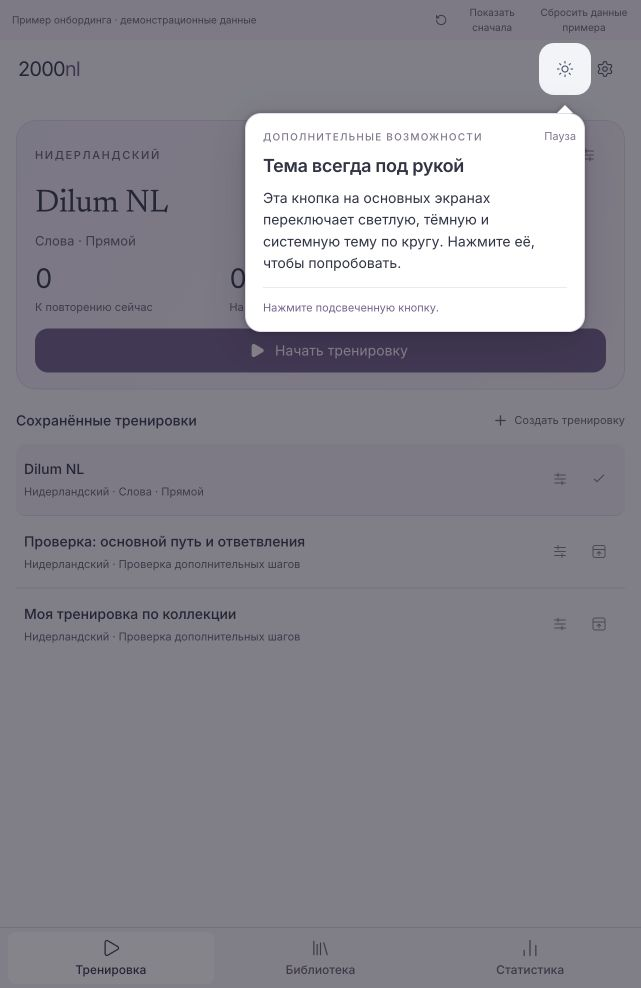
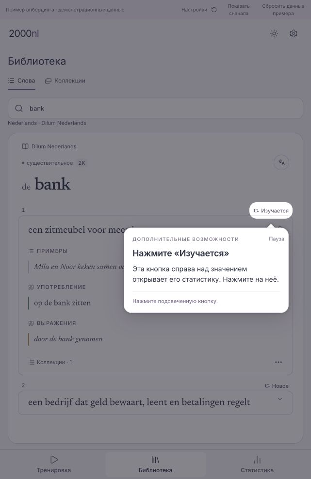
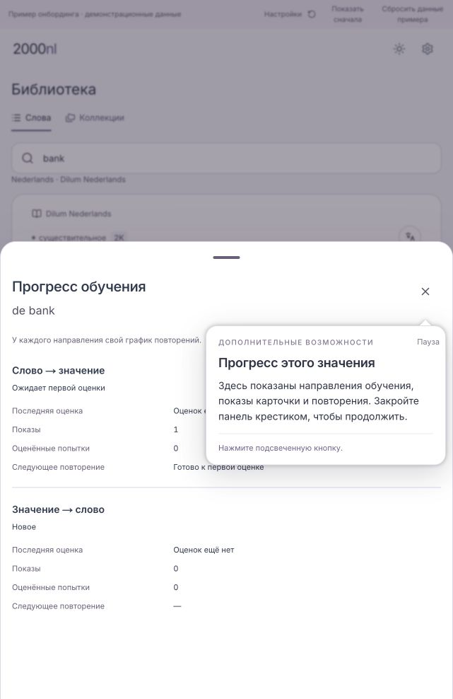
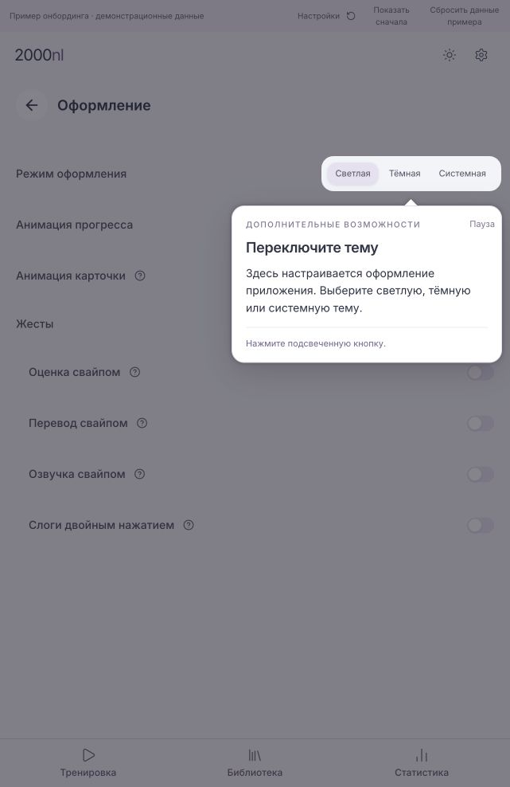
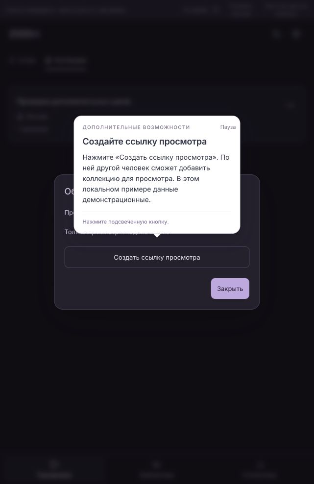
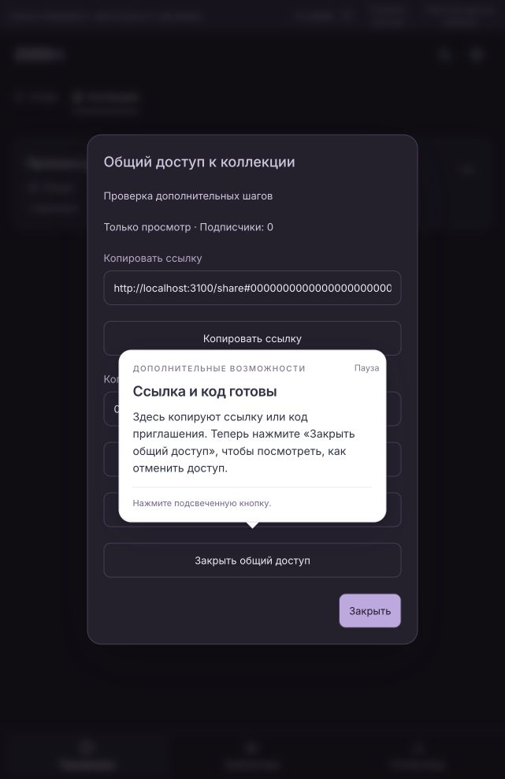
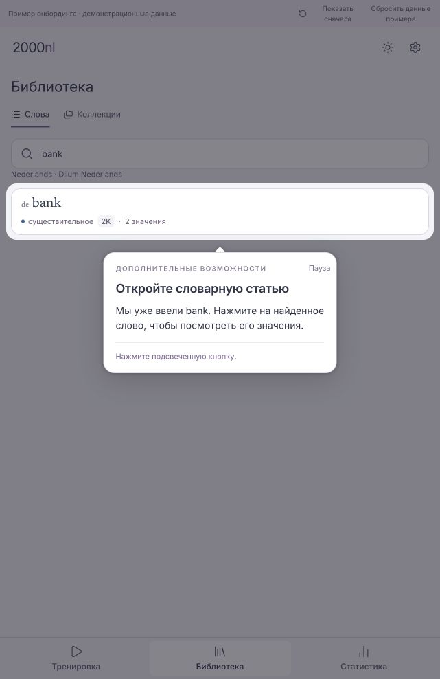

# Action-led onboarding — current review preview

2026-10-30 · #9 · development prototype for owner review.
`http://localhost:3100/dev/onboarding-preview` requires development mode and
`ONBOARDING_PREVIEW_9=true`. Production returns not found.

## Governing interaction rule

Owner correction: onboarding must navigate the existing application, highlight
its actual controls and open its ordinary panels only after the learner clicks.
Do not create alternate teaching screens or replacement dialogs for statistics,
appearance, sharing, languages or reporting. Explanations belong in Joyride
popovers. Earlier synthetic explanatory dialogs/screens (screenshots 32–37) are
superseded; the separate PreviewReport component was removed.

The application UI now supplies:

- **Statistics:** the exact meaning's `meaning-learning-progress-trigger` button
  is highlighted and named in the tooltip, e.g. “Нажмите «Изучается»”. Only clicking
  it opens the actual MeaningLearningProgress panel, with its real directions,
  presentations/attempts and close control. A supplied fixture snapshot avoids
  loading account data. Collection buttons cannot be mistaken for this trigger.
- **Appearance:** app gear → existing settings section (the actual Russian label
  is “Оформление”) → actual ApprovedAppearanceSection theme controls. There is no
  custom light/dark teaching modal. Continue returns to the main screen and
  highlights the always-visible utility theme button; it cycles light → dark → system.
- **Sharing:** app Library navigation → actual LibraryDestinationTabs Collections
  tab → shared PersonalCollectionRow → its ownedCollectionMenuItems Share item →
  actual OwnedCollectionSharingView. The guide follows Create view-only link,
  confirmation, Copy link, Copy code and Close. The tooltip explains sending the
  invitation outside the app and where to close access later.
  Commands operate only on local fixture state, not a published collection.
- **Connect shared cards:** Library → Shared → Added by me → Add by link/code →
  actual InvitationInput (sample code prefilled/read-only) → actual InvitationPreviewView →
  Add to library → View words → cards (the ordinary direct open behavior).
  The collection also appears in the actual received collection list. The accepted source
  persists locally as received/read-only and is available as training material,
  but is excluded from owned collection management. Learning progress is unchanged.
- **Languages:** actual SettingsDestination language buttons/pickers; accepting an
  unchanged choice uses Continue in the tooltip, not invented app buttons.
- **Report:** actual SenseCardReportSheet, with delivery disabled for the preview.
  Its normal fields/buttons remain; there is no separate preview form layout.
- **Onboarding settings:** resume/restart and topic selection are content of a
  Getting started section in the normal SettingsDestination/SettingsLayout,
  replacing the earlier separate settings modal.

Small reusable seams preserve connected production defaults: MeaningLearningProgress
accepts an optional initial snapshot; report delivery defaults to enabled; sharing
separates its existing view from the connected controller; collection row/menu and
library tabs are shared rather than redrawn. Settings can select an initial section
and notify navigation. These are UI/data seams, not account or database changes.

## Short introduction and optional topics

Core: interface language → independent translation language/Off → start the ready
Dilum NL training → introduce word/reveal definition/example/Learn/close session.
Completion offers Done or optional topics, individually or in order:
collections/training → extra card actions → statistics → sharing → connect shared cards → languages →
appearance. Extra card actions cover speaker, three dots/all meanings/return,
Mark as known explanation and Report. Known status is not mutated just to continue.

Library search now starts with **bank already entered** and the result ready.
The guide highlights the result, never asks the learner to type, and keeps the
example field read-only. Pause/resume retains this prepared example. The collection
route continues through specific meaning membership and a saved training.

All guide prose/keys are in `apps/ui/app/dev/onboarding-preview/locales/` and
`content.ts`; topic order is in `PreviewSettings.tsx` (section content, not a dialog).
Interface languages are EN/NL/RU. Startup uses a supported saved interface language,
otherwise English. Translation is independent and uses the application's catalog
picker. Preview preferences validate catalog identity. Fixture translations exist
only for a few languages; unavailable content is not replaced with another language.
Dutch remains the learning language. No translation provider is called.

## Pause and state

A text Pause tour button replaces the confusing tooltip X. The introduction explains
Settings → Getting started → Resume/Start again. Pause saves the task and opens this
normal settings section. Back to app leaves a resume banner. Resume restores the
card side/meaning context; its tooltip is portaled into the actual native dialog.

Independent stores: `2000nl:onboarding-preview:preferences:v1`,
`2000nl:onboarding-preview:journey:v1` and
`2000nl:onboarding-preview:checkpoint:v1`. The checkpoint retains stage, selected
meaning/collection/training, builder draft/name, session count, theme/settings pane
and queued topics. Storage errors are surfaced. Restart resets guidance/draft,
keeping collections and saved trainings; Reset sample data is separate.

Transient editor state reloads at a visible opener: Source, Exercises, Save or the
collection picker. Draft values remain; unsaved collection-name input does not
survive a full reload. Statistics/sharing transient dialogs reload at their entry
control. Dialog targets are resolved from their current actual element. Target
preparation waits for a newly navigated section to exist, then for ancestor animation,
scroll and stable geometry before Joyride mounts.

## Evidence and validation

Russian browser: exact status-button cutout before click; actual progress sheet
only after click; gear → real settings list → Оформление → real theme change;
collection tab/row/menu → actual sharing confirmation/link/code/revoke/close;
actual initial language settings → complete short core; prepared bank result.
Previous checks cover pause/reload/details restoration and builder draft retention.
No full all-topics chain or complete EN/NL walkthrough is claimed for this revision.

Focused tests cover localization/preferences, journey/checkpoint, actual progress
snapshot without fetch, actual report no-send boundary, sharing confirmation,
ready search without typing and separation of statistics/collection triggers.
Connected settings, library navigation, sharing and owner-fence tests also run.
The sharing/recipient revision passed 56 focused/regression tests, UI typecheck
and lint. Russian browser checks completed both owner and recipient paths and
all three header theme modes. The recipient example is local fixture data. Account startup, cross-device
state and release accessibility/missing-target recovery still need integration QA.

The server is isolated from account data: no account identity or connected DB,
no managed rollout, no #8 seeding validation, no real sharing publication or report
delivery. Fixture pronunciation uses browser speech synthesis when available.
The preview server stays running. Earlier screenshots remain historical evidence.
