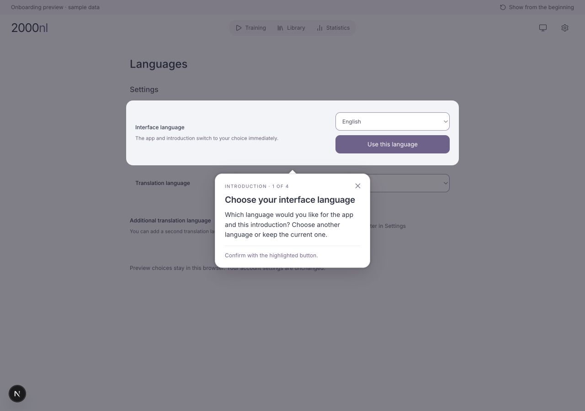
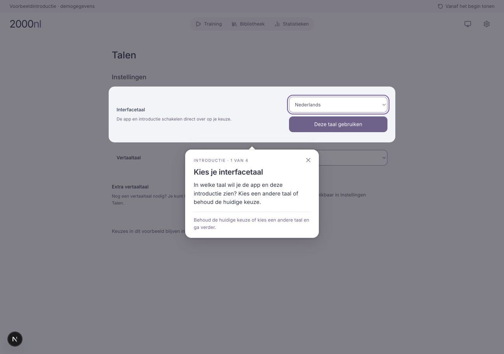
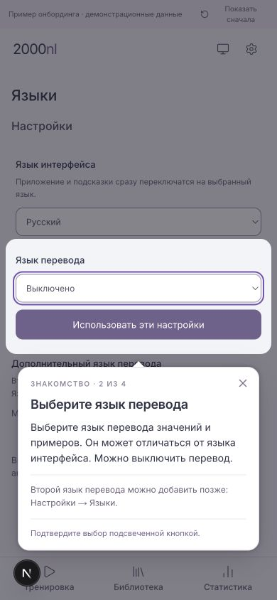

# Action-led spotlight onboarding — current direction

**Current sample:** four localized steps: interface language → translation
language (with a second-language mention) → ready training → reveal answer.
The earlier two-step screenshots below are retained for comparison.

2026-10-30 · #9 · visual sample for owner review; full flow not implemented.

Owner clarified that onboarding must dim the surrounding real interface,
highlight the control to use, and explain the concept in a nearby popover.
The learner clicks the real control; the next step follows the resulting screen
or acknowledged save. A separate training simulation with inline help is not the
desired format. The earlier standalone HTML concept is superseded.

## First actions: language choices

The owner explicitly requested these among the first actions, **before the ready
training walkthrough**:

1. Open Settings → Languages and highlight **Interface language**. Draft: “На
   каком языке показывать приложение и подсказки? Выберите язык интерфейса”.
   Show the saved/detected current choice and allow confirming it unchanged.
   Subsequent guidance must immediately use the chosen interface language.
2. Highlight **Translation language**. Draft: “На какой язык переводить значения
   и примеры? Язык перевода может отличаться от языка интерфейса”. Allow the
   existing Off choice; explain rather than force the use of translations.
   Advance after the actual preference save succeeds; retain choice and retry
   on error. Do not promise optional provider availability.
3. Point out **Additional translation language** briefly: “Если понадобится,
   здесь можно добавить второй язык перевода. Это можно сделать позже”. Do not
   require choosing a second language or expanding its picker now.

This uses existing auto-saving language controls. Do not invent a Save button
where the actual screen auto-saves. A small proposed confirmation to continue
can accept the current values without generating redundant writes. The tour must
not change the learning language when changing the interface language. Return to
the ready primary training after this language segment.

The owner accepted the spotlight format and requested these language choices
first. They are now implemented in the four-step review preview. Full onboarding
and the remaining route are still not implemented. The extra translation
language is only mentioned; no choice is required.

## Language-first implementation and storage

Startup rule: use a supported saved interface language; otherwise English. The
preview first reads its own saved choice and falls back to an available browser
app-language preference. It never writes the app-language key. Actual account
integration must use the authenticated startup preference snapshot before showing
the tour; it must not infer the account language from the browser's locale.

Changing interface language immediately translates the same tooltip, navigation,
controls and following steps. Keeping English needs no change in the selector;
the confirmation button accepts the current value. Translation language is
independent; Off is supported. The material being learned remains Dutch.

Choices are saved only to `2000nl:onboarding-preview:preferences:v1`, a versioned
browser JSON object containing independent interface and translation codes.
Reload/replay keeps the choices and starts this review sample at its first step.
Storage errors are shown and block confirmation from pretending the choice was
saved. This is not account, sign-in or cross-device persistence.

All tour prose, progress labels and controls are in
`apps/ui/app/dev/onboarding-preview/locales/{en,nl,ru}.json`. Stable stage IDs,
targets and translation keys are in `content.ts`; validation, persistence and
English fallback are in `preferences.ts`. The rendering component contains no
Russian step prose. Future interface languages need a locale file, registration
alongside the app's supported interface locales, and the corresponding app UI
translations. Tests check key coverage and configured step titles/bodies.

Language controls reuse SettingsPanel/SettingsRow and existing styling. Native
selects and confirmation buttons belong to this preview; the production settings
screen remains unchanged. The sample offers EN/NL/RU/DE/FR/ES and Off as translation
choices; this is not a replacement for the application's full language catalog.
The example card has a small synthetic word-translation sample; no provider is
called, and unavailable translations are not substituted with another language.

## Earlier two-step sample

Local preview: `http://localhost:3100/dev/onboarding-preview` (now includes language steps).
It is available only in development with `ONBOARDING_PREVIEW_9=true`; production
returns not found. It has no account identity, credentials or database connection.

Actual shared application components: AppFrame, TrainingOverview and
TrainingSenseCardStage. Saved training metadata/counts and card content are
synthetic demonstration fixtures; this does not validate #8's real seeding.
The preview uses installed React Joyride 3.2.0, without adding dependencies.

1. **Ready training:** highlight the real Start button. “Начнём с готовой
   тренировки. В Dilum NL уже выбран материал словаря Dilum Nederlands.
   Настройки можно изменить позже. Нажмите «Начать тренировку»”. Clicking Start
   switches the rendered application components to the card.
2. **Card front:** highlight the real Show answer button. “Вспомните значение.
   Сначала подумайте, что значит слово. Затем откройте ответ — там будут значение
   и пример”. Clicking it invokes the real card's reveal handler; guidance ends
   at the answer. Learn does not write progress in this sample.

There is no simulated Next button. Close dismisses guidance; replay returns to
the first sample screen. The Settings gear replays this sample as a temporary
demonstration shortcut; it does not pretend to be the final Help/Settings UI.
Other navigation/editor actions explain the sample's scope rather than opening
unimplemented screens. Only the two highlighted interactions are under review.

## Library choice

Recommended for this app: **React Joyride**. Its React integration is already
installed; it supports a spotlight, custom popover, clickable target and controlled
steps. The old tour's broken wiring/targets do not demonstrate a library defect.
This sample proves click-through across the first two rendered screens.

- [Joyride interaction options](https://react-joyride.com/docs/props/options)
  and [events](https://react-joyride.com/docs/events).
- [Driver.js](https://driverjs.com/) is a reasonable framework-independent
  alternative with highlights, popovers and interaction hooks.
- [Shepherd](https://www.shepherdjs.dev/) is another alternative with keyboard
  navigation, focus management and framework integrations.

None decides what a dictionary means, selects the user's language, acknowledges
a save, or provides account persistence automatically. Those are application
responsibilities. Full focus management, mobile/zoom and missing-target recovery
must be tested before treating any library as accepted for rollout.

## Full route still to design

Languages → ready primary saved training (#8) → card/reveal → meaning/example/
Learn → Library → choose a meaning → collection membership/create/name → choose
collection as material of a separate training → save/name → return/start.
The owner is still reading/reviewing this route. Decide whether collection and
training creation are an optional continuation; do not call the route approved.

Legacy cleanup should remove obsolete wiring/targets/copy but **retain Joyride
if this library decision is accepted**. Preserve the live language behavior and
stored legacy flags. The earlier audit's dependency-removal recommendation was
conditional on discarding the library; the new visual sample supersedes that part.

## Checks for this sample

UI typecheck and lint of the two preview components passed. Browser checks at
1280×900 and 390×844: actual Start click advances, Show answer click/Enter reveals
the actual card answer, close removes the overlay, and replay returns to the
start. Both mobile popovers and highlighted controls fit; the card's word remains
visible above the second popover. Focus trapping is disabled in this action-led
sample so the actual controls are keyboard reachable; the final tour still needs
a dedicated focus/announcement design. No account persistence or new-user trigger
is implemented. The preview server is left running for the owner's review.

## Language-first validation

- Language/persistence/content tests: 14 passed. UI typecheck and touched-file lint passed.
- Browser: keeping English advances; choosing Russian/Dutch immediately translates
  the same tooltip and UI. English and Dutch routes continue through overview and
  reveal with correct localized targets.
- English UI / Russian translation exercised independently; Dutch UI / Off accepted;
  reload retained Dutch and Off. Russian translation step inspected at 390×844.
- No DB/defaults/setup-seed/legacy flags or account preferences changed. These are
  preview checks, not acceptance of a completed account onboarding release.
