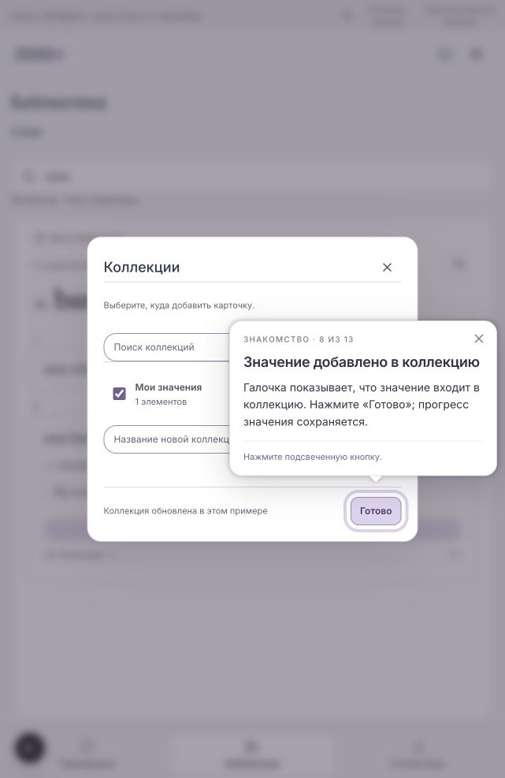
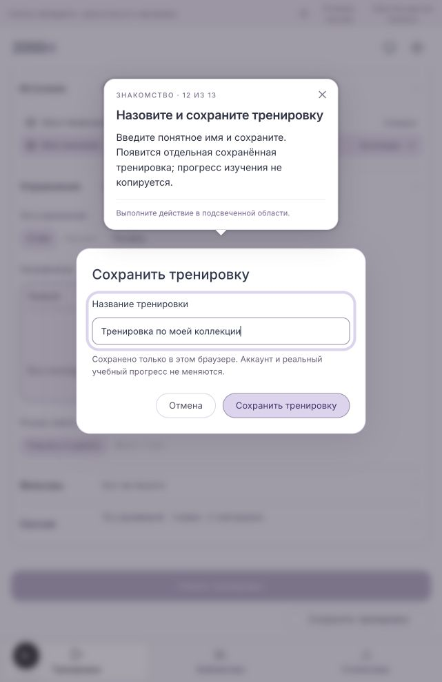
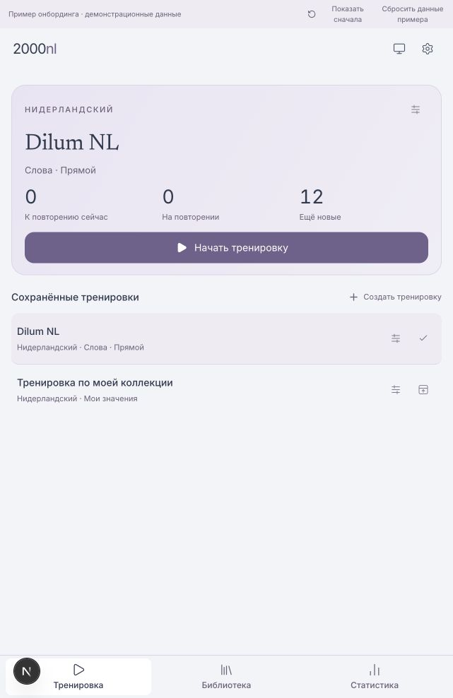
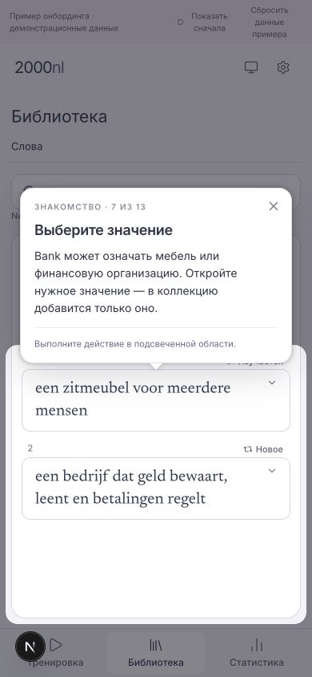
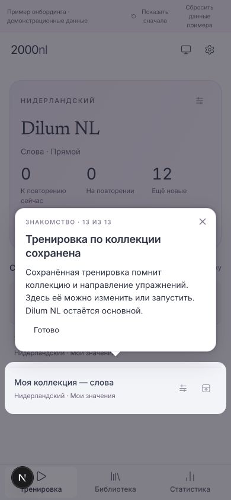
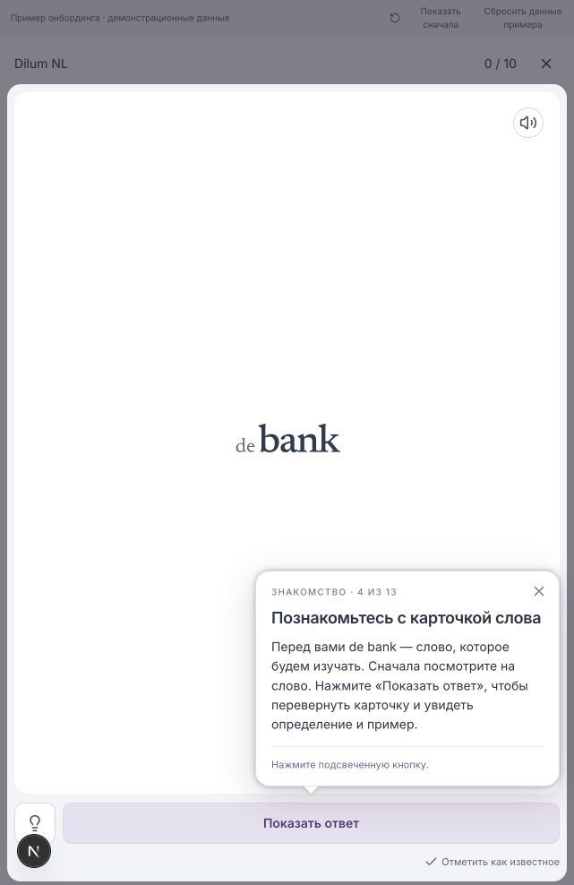
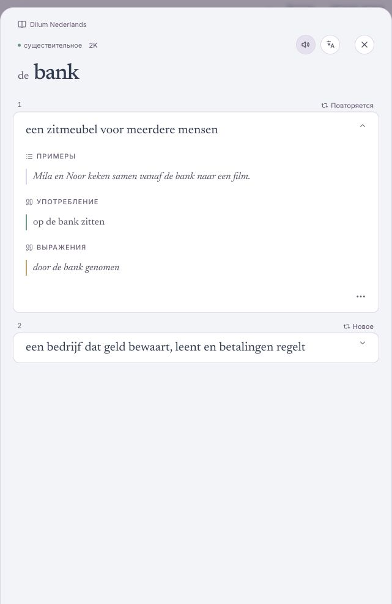
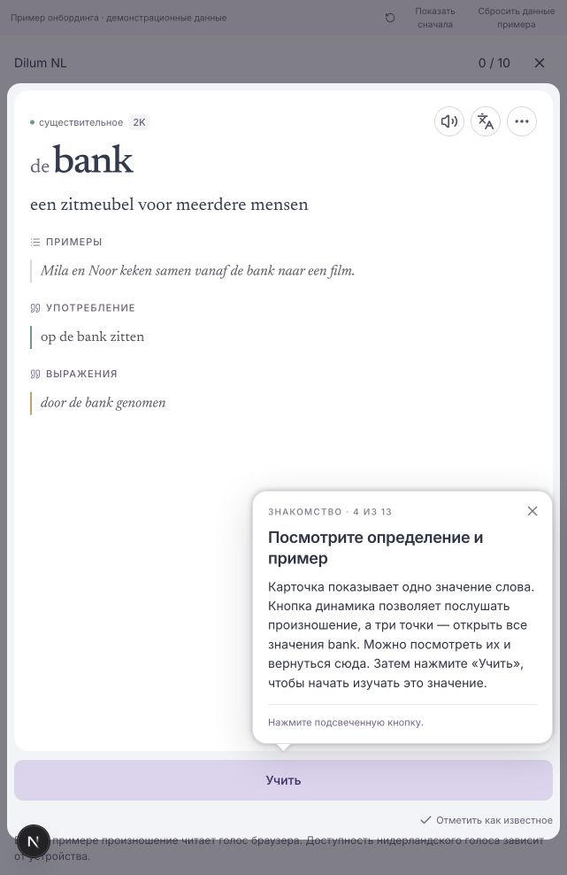

# Action-led spotlight onboarding — review preview

2026-10-30 · #9 · local development preview for owner review.

The owner accepted the spotlight format and requested the complete Library →
meaning → collection → saved collection training path. It is implemented in the
review preview at `http://localhost:3100/dev/onboarding-preview`, enabled only in
development with `ONBOARDING_PREVIEW_9=true`. Production returns not found.
This is a prototype, not an account onboarding release. The standalone HTML
concept is superseded.

## Route to review

The surrounding interface dims, the control stays highlighted, and a nearby
popover explains the action. Steps follow actual clicks or successful local
saves; there is no separate Next button.

1. Choose or confirm interface language.
2. Independently choose translation language, including Off; mention a second
   translation language as an option for later.
3. Start the ready Dilum NL training.
4. Reveal the answer, read the definition/example, choose Learn and close the session.
5. Open Library using the real navigation.
6. Search for `bank` and open the result.
7. Choose furniture or financial meaning; only the chosen meaning joins the collection.
8. Open Collections, create/name a collection or check an existing one, confirm
   membership and close the picker.
9. Return to Training and choose Create training.
10. Expand Source and choose the collection.
11. Expand Exercises and choose Direct; explain word → meaning and the reverse option.
12. Save training, enter its name and submit the actual save dialog.
13. Highlight the saved training and finish. It can then be loaded, launched or
    edited. Dilum NL remains primary.

These 13 conceptual sections have 23 action states. Stable IDs, targets and keys
are in `apps/ui/app/dev/onboarding-preview/content.ts`; all tour prose, progress
and controls are in adjacent `locales/{en,nl,ru}.json`. Future languages need a
locale registration plus the corresponding application UI messages.

## Components and state

Shared real components: AppFrame, TrainingOverview, TrainingSenseCardStage,
LibraryHeadwordGroupResultsList, LibrarySenseCardGroup, LibraryCollectionsPicker
and ApprovedTrainingBuilder. Fixture content and availability are synthetic.
There is no account identity or connected database; this does not validate #8
seeding. Installed React Joyride 3.2.0 supplies the spotlight without a new
dependency. Driver.js and Shepherd are alternatives; the accepted format does
not require a library change.

Startup uses a supported saved interface language, otherwise English. It reads
its own preview preference, then an available saved app-language preference,
and never writes the app-language key. Switching translates the tooltip and UI
immediately; the learning language remains Dutch. Translation language is
independent. SettingsPanel/SettingsRow styling is shared; selectors and explicit
confirm buttons belong to this preview. Translation choices EN/NL/RU/DE/FR/ES
and Off are a small sample, not the full application catalog. No translation
provider is called.

Separate versioned browser stores:

- `2000nl:onboarding-preview:preferences:v1`: interface and translation languages.
- `2000nl:onboarding-preview:journey:v1`: collections referencing meaning IDs,
  saved training drafts referencing collections, synthetic learned-meaning IDs.

Membership does not copy meanings or reset progress. Saved training retains the
collection and exercise direction. Reload retains both stores and starts the
guide at the beginning. Storage failure displays an error and blocks pretending
to save. Show from beginning replays without clearing; Reset sample data clears
only the synthetic journey, retaining language choices. Account settings and
real progress are untouched.

Native collection/name dialogs keep their own dimmed backdrop. Joyride's popover
is placed inside the active dialog to remain in the browser top layer; preview
styling highlights its form/footer. Normal screens use Joyride's overlay/cutout.
Before measuring, target preparation waits for ancestor accordion transitions,
scrolls the target into view and waits for stable geometry.

## Evidence and checks

18 focused tests cover locale/key completeness, fallback, independent language
persistence, exact meaning membership without progress reset, training persistence,
invalid state and storage failure. UI typecheck and touched-file lint passed.

Browser checks exercised the Russian route on desktop/narrow layouts, creating
and reusing a collection, save/reload, editing, and launch using the chosen financial
meaning. The narrow check used 390×844. The meaning popover leaves both choices
visible. Source/direction cutouts were checked after accordion expansion; a
locator-induced scroll needed the overlay's scroll update before clicking.
Earlier language checks covered English/Dutch immediate switching, independent
Russian translation/Off and reload. Extended English/Dutch routes have key tests,
not a full browser walkthrough yet.

Close dismisses guidance; Settings temporarily replays the sample. Account startup
triggers/saves, cross-device persistence, missing-target recovery and release
accessibility validation remain outside this prototype. Focus trapping is disabled
so actual controls stay keyboard reachable. No DB/defaults/setup-seed/legacy flags
changed. The local server is left running for owner review.

Screenshots 12–18 retain the earlier two-step/language-first samples for comparison.
This document supersedes those limited route descriptions and the earlier audit's
conditional dependency-removal advice.

## Card review correction

Owner feedback: introduce the word before asking for recall; preserve the answer
when leaving, and expose audio plus the three-dot word details action. The card
segment now highlights the entire card while anchoring the explanation to the
reveal/Learn action. Both EN/NL/RU copies introduce the word and explain that the
answer represents one meaning. Audio and word details handlers were previously
omitted by the preview, which hid those shared-card controls.

The preview now connects both handlers. The three dots open the shared
TrainingDetailsDrawer with both bank meanings; closing returns to the same answer
and resumes its guidance. The details model uses the preview's learned-meaning
state and translation selection. Learn preserves the revealed answer at the exit
step. No shared production card behavior changed.

Pronunciation uses browser speech synthesis for this isolated sample, with a Dutch
local voice when available. A note explains device voice availability. This does
not test the production audio resolver or assert audio quality. Browser verification
confirmed face/reveal, visible audio/details controls, opening/closing both-meaning
details, invoking pronunciation, and retaining the definition after Learn. Focused
18 tests, typecheck and touched-component lint passed again.

